<p align="center">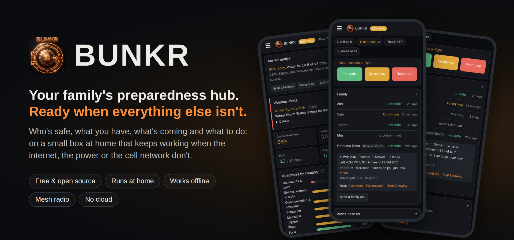</p>

<p align="center"><b>Free and open source · runs on a small box at home · keeps working with the internet off<br>
No cloud account, no subscription, no AI required</b></p>

<p align="center"><a href="#try-it-in-one-minute">Try the demo</a> · <a href="#a-quick-tour">Take the tour</a> ·
<a href="deploy/INSTALL.md">Install</a></p>

When a storm takes the power out, the cell network is jammed and the news is everywhere at once, a family needs four
answers fast: **Is everyone safe? What do we have? What's coming? What do we do?** BUNKR keeps those answers on a
server in your own house, on everyone's phone, on a Raspberry Pi in the go-bag and on a USB stick in the safe, and
keeps them working when the internet doesn't.

## Why BUNKR

<table>
<tr>
<td width="33%" valign="top"><h3>🟢 Know everyone's OK</h3>One tap: safe, on my way, need help. The whole family sees it.
Check in for Grandma, follow a flight in the air, and send "meet at…" to everyone at once.</td>
<td width="33%" valign="top"><h3>🥫 Know what you have</h3>Water and food counted in <i>days</i> for your household, every
item in its place, go-bags per person, expiry dates watched, and a shopping list of exactly what's missing.</td>
<td width="33%" valign="top"><h3>⚠️ Know what's coming</h3>Official alerts, fires, quakes and outages ranked by how close
they are to <i>your</i> people, news from many regions in one morning brief, and a saved forecast for when the internet's down.</td>
</tr>
<tr>
<td valign="top"><h3>📡 Works when it all goes down</h3>The app keeps working offline. A Pi field kit carries a copy of
everything, and a MeshCore radio carries check-ins and alerts with no internet or cell service at all.</td>
<td valign="top"><h3>🔒 Yours alone</h3>Runs on your hardware, with your data in your house. Passkeys, two-step login and an
audit log. Firearms and serial numbers never leave the hub. BUNKR never shares your data with anyone.</td>
<td valign="top"><h3>🧩 Only what you use</h3>Turn on the pieces your household has: radios, field nodes,
Home Assistant, optional AI. Everything else stays out of the way.</td>
</tr>
</table>

## See it in action

<table>
<tr>
<td width="340" valign="top">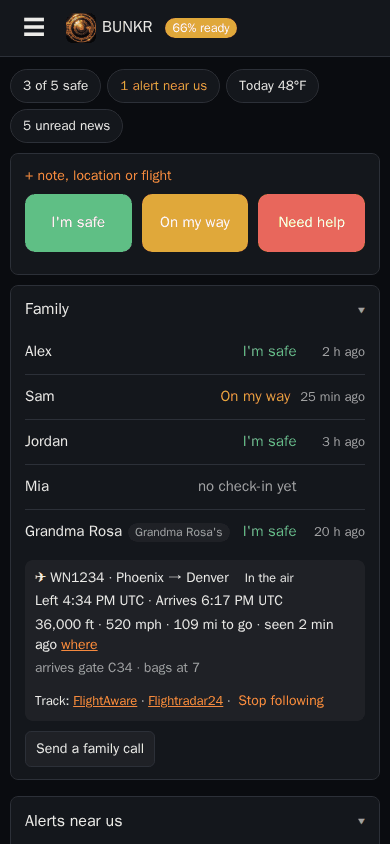</td>
<td valign="top">

**In 15 seconds:**

1. Alex taps **On my way**, and the family board updates for everyone.
2. Mia is at the library without her phone, so Alex checks her in, with a note.
3. **Readiness**: 66% ready, 10.8 of 14 days of water, the weakest categories first.
4. The **morning brief** shows how outlets from different regions tell the same story.
   "Done with this" clears a story from Alex's brief only.

</td>
</tr>
</table>

On a computer, everything fits on one screen:

<p align="center">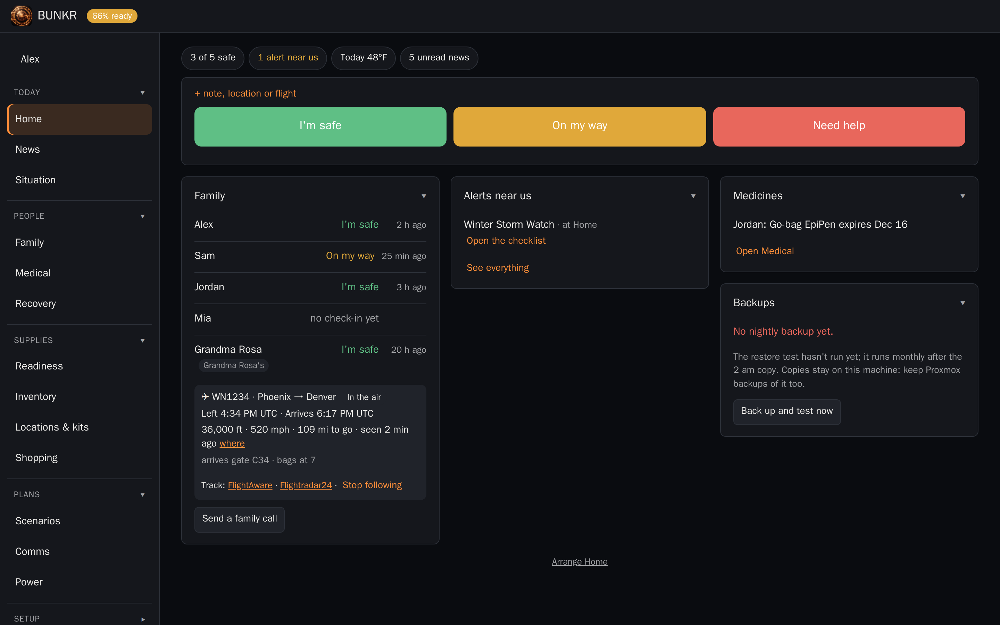</p>

## Try it in one minute

Every picture here is the demo household, the made-up Rivera family. Try it yourself, with nothing to set up and
nothing fetched or sent: download or clone this repository, then in its folder run

```
python3 -m bunkr --demo
```

and open http://127.0.0.1:8765. It runs in a temporary folder and is gone when you stop it. All it needs is Python 3.12.

## Your first day

New household? Do these in order. Each takes a few minutes.

1. **Make a login** for yourself, then one for each adult in the family (Household).
2. **Add your people** on Family: names, phones, and who's a child.
3. **Set your home** on Sites & maps, so alerts and weather are for your town.
4. **Add what you have.** Start with water and food: Inventory, "Add one item" or "Scan a barcode". Put each item in a place (Locations).
5. **Look at Readiness.** It shows how many days of water and food you have, and what's missing. The shopping list is built from that.
6. **Check in.** Everyone taps "I'm safe" on Home once, so you all see how it works.
7. **Turn on notifications** on My account, on every phone.

Radios, news sources, a field kit and the rest can wait until the basics are done.

## A quick tour

### Everyone checks in
One tap says you're safe, on your way or need help, and it shows on everyone's Home screen. Check in for someone who
can't (Grandma, a kid at school), and follow a family member's flight while they're in the air.

<p>
  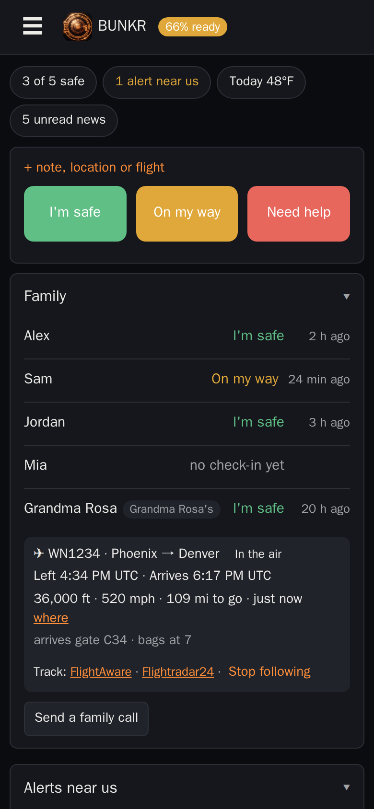
  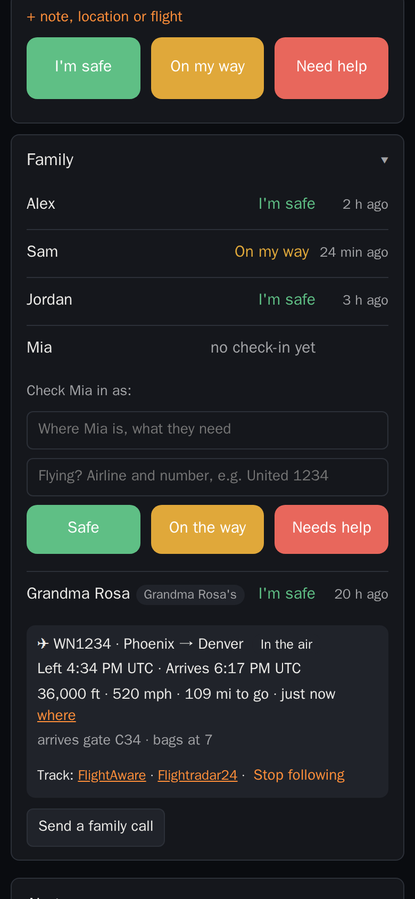
  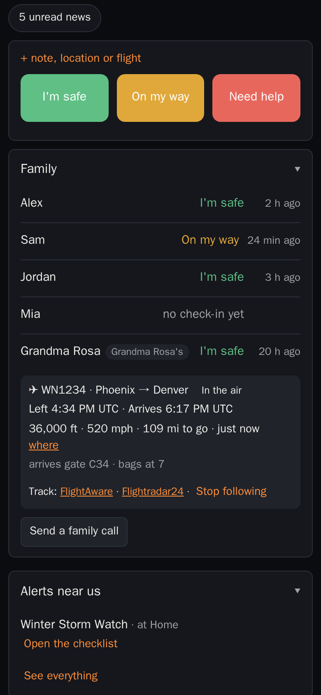
</p>

### Know what you have
Supplies counted in days of water and food for your household, by category and against Ready.gov's list. Every item
lives somewhere: places inside places, go-bags per person, printable bin labels with QR codes. What's missing becomes
the shopping list.

<p>
  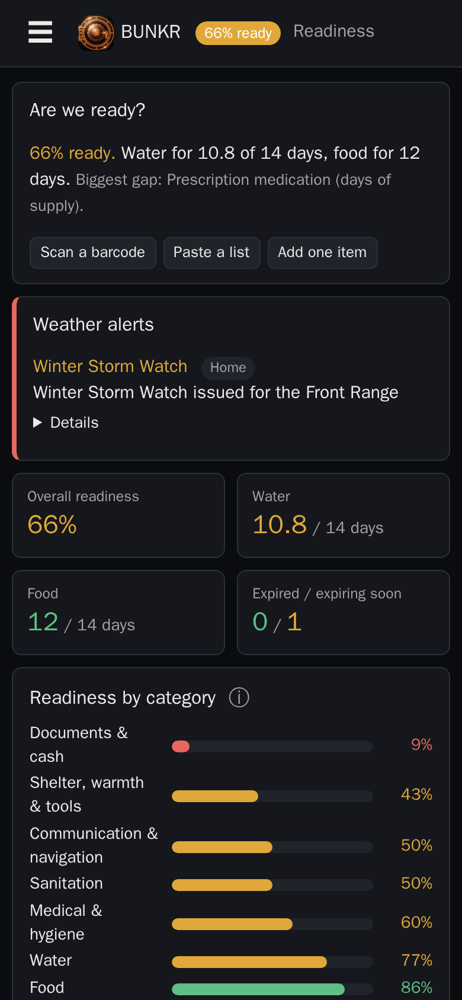
  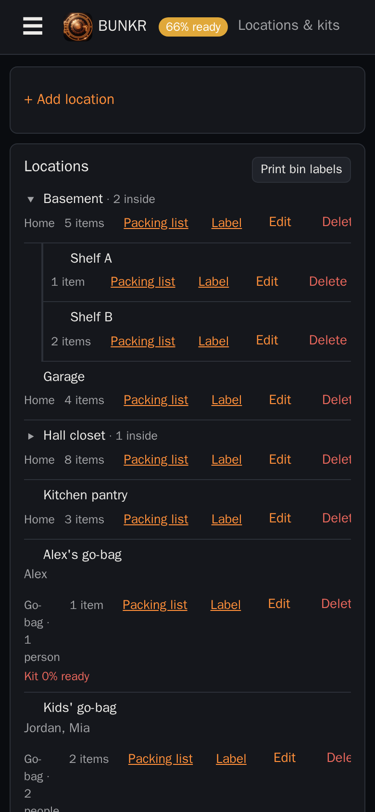
  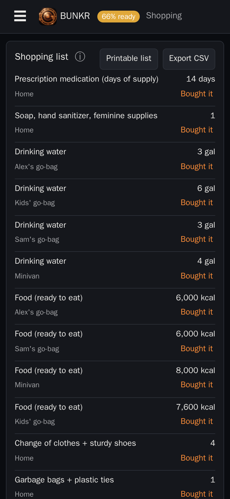
</p>

<p>
  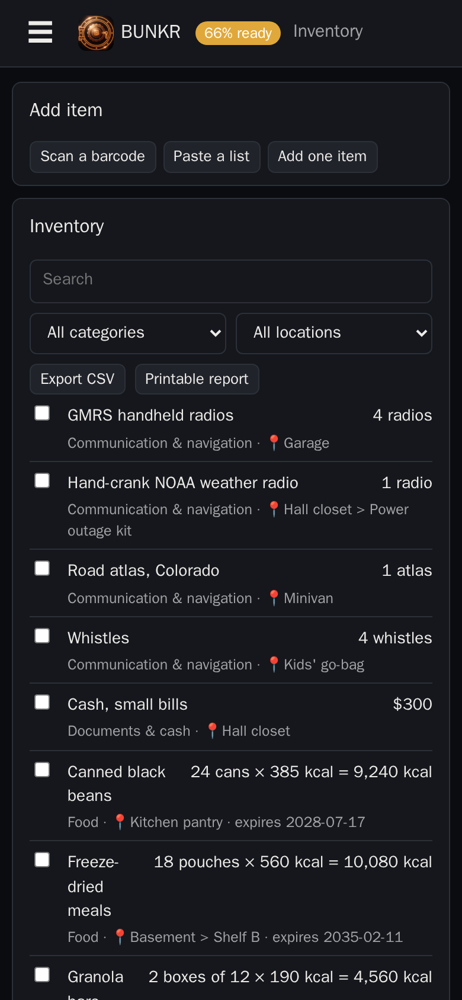
  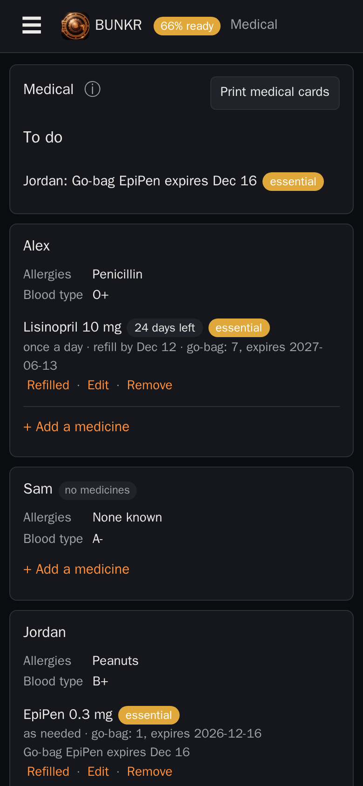
  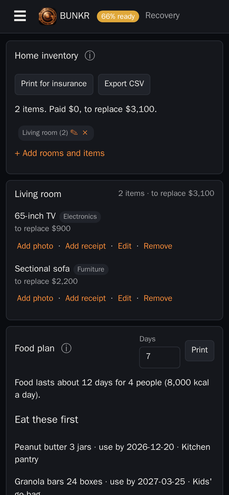
</p>

### Know what's happening
Official alerts, fires, quakes and outages ranked by how close they are to your people. News from many regions grouped
into stories, with a morning brief each person can train ("Done with this", "Not for me"). The forecast is saved every
few hours, so it's still there when the internet isn't.

<p>
  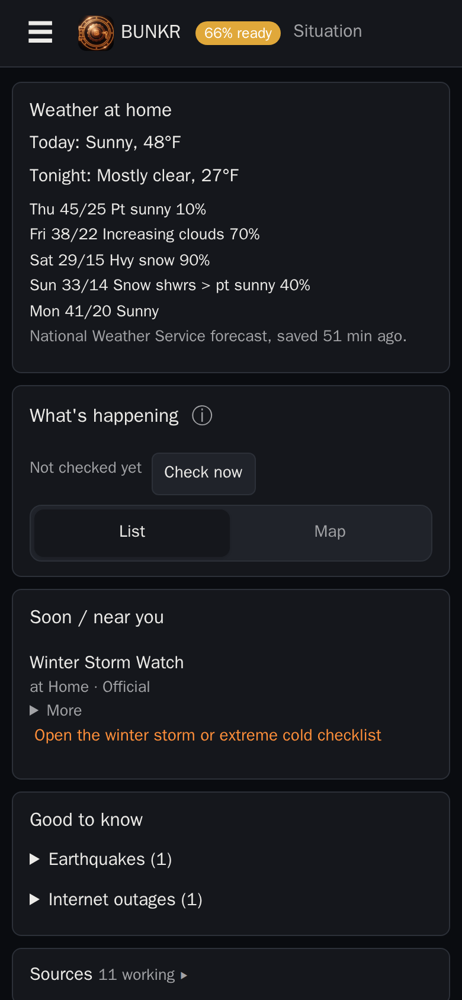
  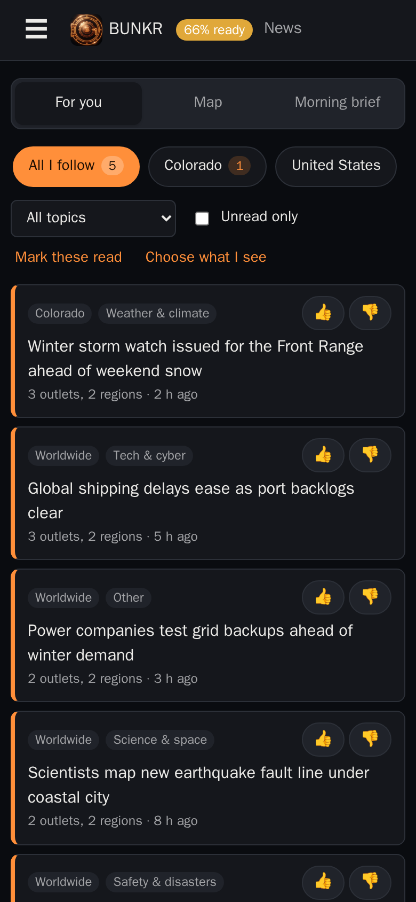
  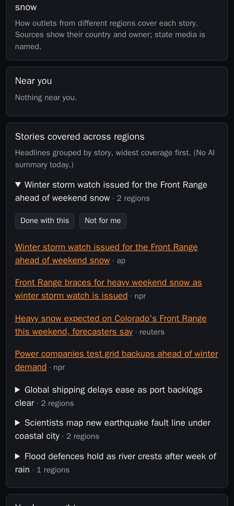
</p>

<p>
  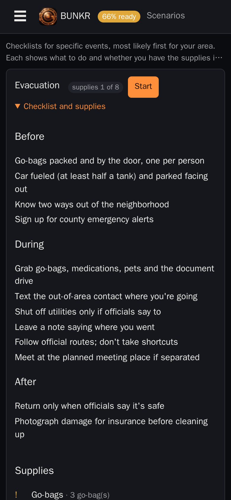
  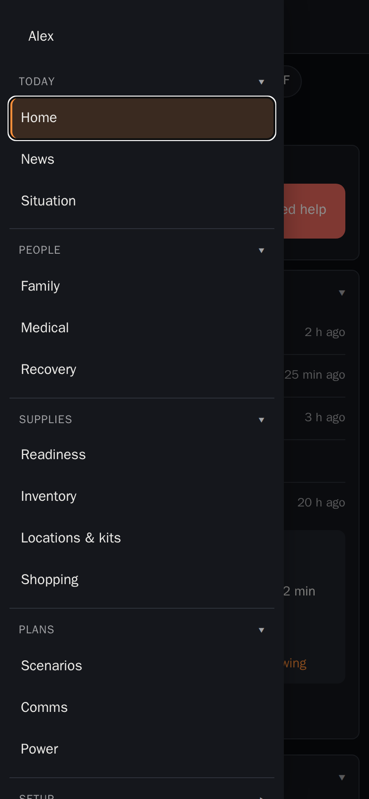
</p>

### Keeps working when things go down
BUNKR is built for the day the internet is out. The web app keeps the last data it saw. A Raspberry Pi or laptop
"field kit" carries a copy of the hub and serves check-ins over its own Wi-Fi. A MeshCore radio carries check-ins,
family calls and a small command bot (weather, alerts, headlines) with no internet at all. USB drives hold encrypted
documents, offline maps, Kiwix libraries (medicine, repair, Wikipedia) and radio programming files.

<details>
<summary><b>Everything it does</b></summary>

- **Supplies and readiness:**
  - Inventory by location and kit, with targets from Ready.gov's [Build a Kit](https://www.ready.gov/kit) list, scaled to your household.
  - Water and food counted in days; expiry tracking; a shopping list from your gaps.
  - Barcode quick-add and scenario checklists.
- **Family:**
  - Check-ins ("I'm safe / on my way / need help"), with battery level, and family calls ("meet at…", "evacuate to…"), with drills.
  - Medical cards and medicine supply; a printable family plan; a maintenance calendar.
- **Notifications:**
  - Phone push (Web Push, end-to-end encrypted), a notification inbox, and reminder emails through your own mail account.
  - Document renewal reminders.
- **Situation:**
  - NWS alerts and hazards for your places, wildfires, earthquakes, space weather, internet outages and cyber advisories, ranked by how close they are.
- **News:**
  - Headlines from many outlets and regions, grouped into stories and ranked for each person, plus a morning brief.
  - Early warning for hacks, outages and dangers near your people.
  - A news search for each family town.
  - Anyone can flag a source that doesn't belong to its story, so the grouping learns.
- **Flights:** follow family flights (adsb.lol, FAA delays, optional FlightAware).
- **Mesh radio:**
  - Family check-ins and calls over a MeshCore companion radio (USB or Wi-Fi), with several channels.
  - A small command bot, and a list of known nodes by public key.
- **Offline kit:**
  - Encrypted document archives (7-Zip AES-256) and Kiwix offline libraries (medicine, repair, Wikipedia).
  - Offline maps, radio programming files (CHIRP), and firmware for mesh boards.
  - All of it on USB drives and on field nodes.
- **Field nodes:** a Pi or laptop syncs from the hub and serves a read-only field page and check-ins over its own Wi-Fi.
  Optional "node lock" keeps its database encrypted until it's back home.
- **Security:**
  - Logins, passkeys, two-step login and an audit log.
  - Firearms and serial numbers are admin-only and never leave the hub.
- **Optional extras:** Home Assistant.
- **Optional AI, off by default:** AI summaries in the morning brief, and an AI connector (MCP). See below.


The offline app works on phones as an installed web app (Add to Home Screen) and keeps the last data it saw when
the connection drops.

</details>

## Run it

BUNKR is written in Python 3.12 using only the standard library (plus Ubuntu's `python3-cryptography`), with
SQLite and a plain HTML/JS phone-friendly web app. No pip packages, no cloud account.


Try it on one computer:

```
./run.sh                       # or: python3 -m bunkr
```

It opens http://127.0.0.1:8765 and only listens on that computer. Data goes in `~/.local/share/bunkr/bunkr.db`.

For a hub, a Raspberry Pi field node or a laptop node, see [deploy/INSTALL.md](deploy/INSTALL.md).

Requirements (Ubuntu or Debian): `python3` (3.12), `python3-cryptography`, `7zip`, `rsync`. Optional: `tesseract-ocr`, to read calories off nutrition label photos.

## Keys and outside services

Everything works without accounts. Some extras need your own free or paid keys, saved on the hub in files only
BUNKR can read:
- NASA FIRMS (wildfires) and Cloudflare Radar (internet outages);
- FlightAware AeroAPI (flight times);
- a mail account (reminder emails);
- Home Assistant;
- Kroger's product catalog (barcode lookups for Kroger-family stores and store brands);
- USDA FoodData Central (works without a key; a free api.data.gov key allows more lookups).

Each install uses its own keys, and BUNKR never shares data with anyone else.

## AI is optional

BUNKR doesn't need AI or any AI subscription. A new install has it off, and every feature works without it. If you
want it, one card on the Household tab ("AI (optional)") turns on:
- **AI summaries:** the morning brief says where outlets agree and differ, and news stories get sorted by place and topic.
- **AI connector (MCP):** an AI assistant can read your inventory and add or move items, after you sign in. Never firearms.

It can run on a free local model (Ollama, on your own computer) or any command-line AI tool on the hub that reads a
prompt and prints a reply (you set its command on the hub, see deploy/INSTALL.md). The connector works with any AI app that supports
MCP connectors: list its sign-in callback address on the card. Nothing else in BUNKR uses AI.

## Versions and upgrades

Releases are numbered MAJOR.MINOR.PATCH and listed in [CHANGELOG.md](CHANGELOG.md) and on the GitHub Releases page.
Once a day the hub checks for a newer release and tells its admins; it never updates itself. Upgrade when you
choose: see "Upgrading" in [deploy/INSTALL.md](deploy/INSTALL.md). The check can be turned off on the Household tab.

## Tests

```
python3 -m unittest discover -s tests
```

## Design

[DESIGN.md](DESIGN.md) explains how the pieces fit together.

## Support BUNKR

BUNKR is free and stays free. If it helps your family and you'd like to say thanks, you can sponsor it on
[GitHub Sponsors](https://github.com/sponsors/MrPatzy) or [buy me a coffee](https://buymeacoffee.com/zachpatzm).
Bug reports and pull requests help just as much.

## Disclaimer

BUNKR is a personal tool shared as-is. It is not an official alert service, not medical advice, and no
substitute for your local emergency services, official alerts (Wireless Emergency Alerts, NOAA Weather Radio,
your county's alert sign-up) or your own judgment. News can be wrong.

## Licence

Copyright (C) 2026 the BUNKR contributors.

BUNKR is free software: you can redistribute it and/or modify it under the terms of the GNU Affero General Public
License as published by the Free Software Foundation, either version 3 of the License, or (at your option) any
later version. It is distributed in the hope that it will be useful, but WITHOUT ANY WARRANTY; without even the
implied warranty of MERCHANTABILITY or FITNESS FOR A PARTICULAR PURPOSE. See [LICENSE](LICENSE) for details.

If you run a modified version for other people over a network, the AGPL asks you to offer them your source code.
